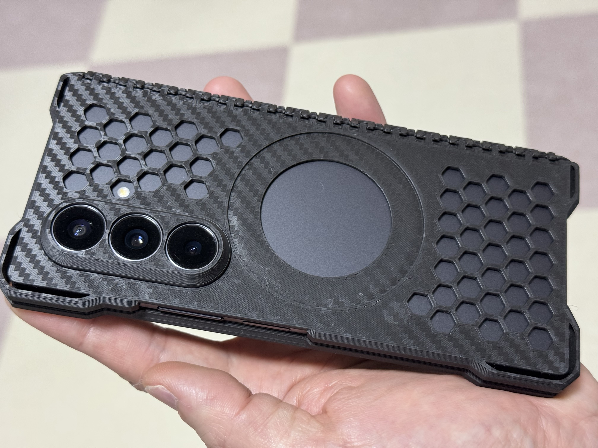
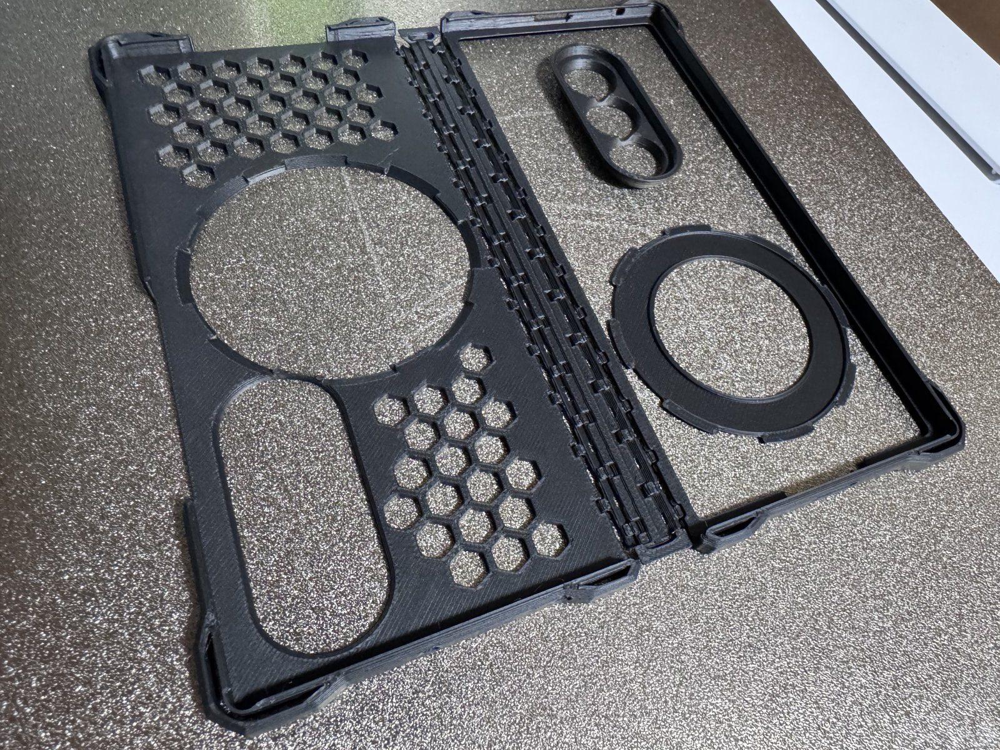
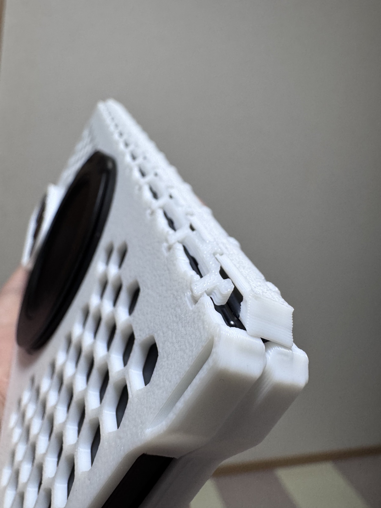
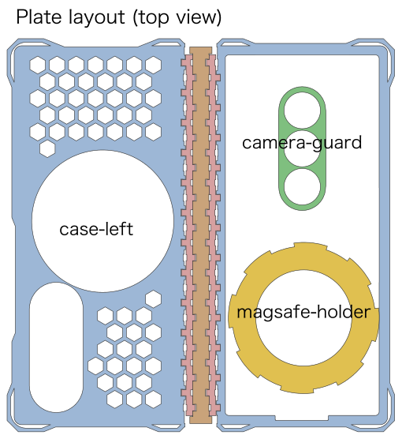

# Galaxy Z Fold7 Hinge-Integrated Case (print-in-place)

[日本語は下にあります](#日本語)

A full-coverage case for the Galaxy Z Fold7. Both case halves and the hinge cover print in one go, already linked together — no assembly needed.
The camera guard and the MagSafe holder are separate parts, placed on the same plate inside the cover-screen window.

| Printed plate | Hinge side, closed |
|---|---|
|  |  |

## Files

| File | Contents |
|---|---|
| `3mf/galaxy-z-fold7-case-bambu.3mf` | Bambu Studio project: the whole case + camera guard + MagSafe holder (1.0) on one plate |
| `3mf/galaxy-z-fold7-case.3mf` | The same plate as a plain 3MF (for other slicers) |
| `3mf/galaxy-z-fold7-magsafe-holder-1.4-1.8-bambu.3mf` / `3mf/galaxy-z-fold7-magsafe-holder-1.4-1.8.3mf` | Thicker MagSafe holders (1.4 and 1.8) on a separate plate |
| `stl/galaxy-z-fold7-<part>.stl` | Each part as STL (the MagSafe holder in 1.0 / 1.4 / 1.8) |

## Printing
- Tested on a Bambu Lab P1S with PLA, default slicer settings (0.20 mm Standard).
- About 79 min and 26 g of PLA for the main plate.
- PETG also works.
- TPU is not recommended: it is too soft, so the case bends and comes off the phone while unfolding.
- Print without changing the layout or settings. The hinge relies on precise gaps between parts; scaling or changing settings may stop it from moving.

## Parts
- `case-left` / `case-right`: the two case halves (the cover-screen side has an open window)
- `guard` / `link-left` / `link-right`: the hinge cover (prints attached to the case halves)
- `camera-guard`: a ring around the camera, tapered so it does not catch in a pocket. It prints upside down (the lens-side end on the bed). Insert it from the inside of the case, flange toward the phone.
  The camera guard and the case changed together in v1.2; do not mix them with v1.1 or older parts.
- `magsafe-holder`: a thin part that fits the MagSafe opening and holds a magnet ring.

## Using the MagSafe holder
1. Put a MagSafe magnet ring sticker (about 55 mm OD, 45 mm ID, 0.5 mm thick) into the groove of the holder (the phone side).
   Rings up to 57.6 mm OD, at least 43.4 mm ID and up to 0.8 mm thick fit.
2. With the groove facing the phone, press the holder into the MagSafe opening from the inside of the case. Its eight lobes lock into the notches so it does not rotate.
3. Once the phone is in, the magnet ring is held between the phone and the holder — no glue needed.

Thicker holders have a thicker outer skin for strength and a firmer fit; the magnet groove is the same. All of them fit the same case.
- 1.0 (standard, on the main plate): the outer face sits 0.8 mm below the case surface, so the charger nests into it.
- 1.4: sits 0.4 mm below.
- 1.8: flush with the case surface.

## License
[CC BY-SA 3.0](https://creativecommons.org/licenses/by-sa/3.0/)

---

## 日本語

Galaxy Z Fold7 用の全面ケースです。左右のケースとヒンジの保護部を、つながった状態のまま 1 回で刷ります (組み立て不要)。
カメラガードと MagSafe ホルダーは別部品で、同じ造形板の外画面の窓の中に並べてあります (写真と配置の図は上にあります)。

### ファイル

| ファイル | 中身 |
|---|---|
| `3mf/galaxy-z-fold7-case-bambu.3mf` | Bambu Studio のプロジェクト: ケース一式 + カメラガード + MagSafe ホルダー (1.0) を 1 枚に |
| `3mf/galaxy-z-fold7-case.3mf` | 同じ造形板の汎用の 3MF (他のスライサー向け) |
| `3mf/galaxy-z-fold7-magsafe-holder-1.4-1.8-bambu.3mf` / `3mf/galaxy-z-fold7-magsafe-holder-1.4-1.8.3mf` | 厚み違いの MagSafe ホルダー (1.4・1.8) を別の造形板に |
| `stl/galaxy-z-fold7-<部品>.stl` | 部品ごとの STL (MagSafe ホルダーは 1.0・1.4・1.8) |

### 印刷
- Bambu Lab P1S・PLA で確認済み。スライサーの設定は既定のまま (0.20 mm Standard)。
- 本体の造形板で 約 79 分・PLA 約 26 g。
- PETG でも使えます。
- TPU はお勧めしません。柔らかすぎて、開くときにケースが撓み、端末から外れます。
- 配置と設定を変えずに刷ってください。ヒンジは部品どうしの隙間を前提にした形なので、拡大縮小・設定の変更で動かなくなることがあります。

### 部品
- `case-left` / `case-right`: 左右のケース (外画面の側は窓が開いています)
- `guard` / `link-left` / `link-right`: ヒンジの保護部 (ケースとつながったまま刷れます)
- `camera-guard`: カメラのまわりを囲む筒。ポケットで引っ掛からないよう、外面を先細りにしてあります。逆さ (レンズの側の端を造形面) に刷ります。つばを端末の側にして、ケースの内側からはめます。
  v1.2 でカメラガードとケースの受けを一緒に変えたので、v1.1 以前の部品と混ぜないでください。
- `magsafe-holder`: MagSafe の穴にはめる薄い部品。磁石板を入れて使います。

### MagSafe ホルダーの使い方
1. 市販の MagSafe 用の磁石板 (リング状、外径 55・内径 45・厚み 0.5 程度) を、ホルダーの溝 (端末の側) に入れます。
   外径 57.6 以下・内径 43.4 以上・厚み 0.8 以下の板が入ります。
2. 溝を端末の側に向けて、ケースの内側から MagSafe の穴にはめます。8 枚の山が穴の切り欠きにはまり、回りません。
3. 端末を入れると、磁石板は端末とホルダーに挟まれて固定されます (接着不要)。

厚み違いのホルダーは、外側の皮を厚くして強度とはめたときの安定感を高めたもので、磁石を入れる溝は同じです。どれも同じケースにはまります。
- 1.0 (標準、本体の造形板): 外面がケースの外面から 0.8 引っ込み、充電器がはまり込みます。
- 1.4: 0.4 引っ込みます。
- 1.8: ケースの外面とそろいます (面一)。

### ライセンス
[CC BY-SA 3.0](https://creativecommons.org/licenses/by-sa/3.0/deed.ja)
