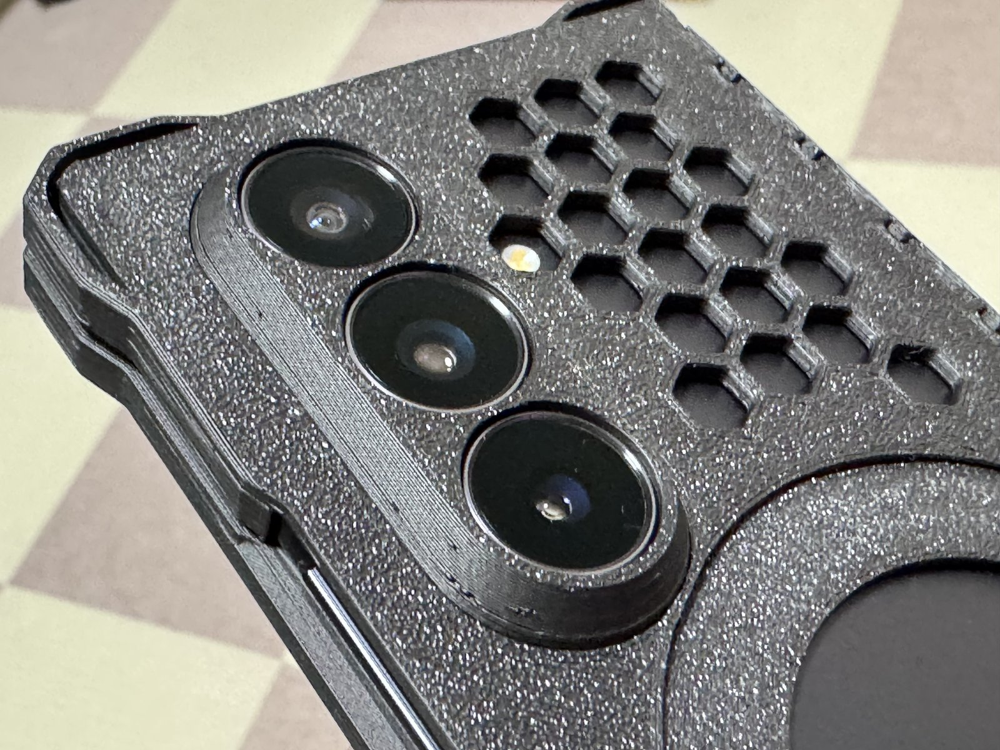

# Galaxy Z Fold7 Hinge-Integrated Case (print-in-place)

[日本語は下にあります](#日本語)

A full-coverage case for the Galaxy Z Fold7. Both case halves and the hinge cover print in one go, already linked together — no assembly needed.
The camera guard and the MagSafe holder are separate parts, placed on the same plate inside the cover-screen window.

| Printed plate | Camera guard | Hinge side, closed |
|---|---|---|
|  |  |  |

## Files

| File | Contents |
|---|---|
| `3mf/galaxy-z-fold7-case-bambu.3mf` | Bambu Studio project: the whole case + camera guard + MagSafe holder (1.0) on one plate |
| `3mf/galaxy-z-fold7-case.3mf` | The same plate as a plain 3MF (for other slicers) |
| `stl/galaxy-z-fold7-<part>.stl` | Each part as STL |

## Printing
- Tested on a Bambu Lab P1S with PLA, default slicer settings (0.20 mm Standard).
- About 78 min and 24 g of PLA.
- Use 0.20 mm layers. The clips that hold the phone are shaped for them; with 0.08 mm layers (Extra Fine) the case was loose on the phone.
- PETG also works.
- TPU is not recommended: it is too soft, so the case bends and comes off the phone while unfolding.
- Print without changing the layout or settings. The hinge relies on precise gaps between parts; scaling or changing settings may stop it from moving.

## Parts
- `case-left` / `case-right`: the two case halves (the cover-screen side has an open window)
- `guard` / `link-left` / `link-right`: the hinge cover (prints attached to the case halves)
- `camera-guard`: a ring around the camera, tapered so it does not catch in a pocket. It prints upside down (the lens-side end on the bed). Insert it from the inside of the case, flange toward the phone.
  v1.4 changed the case, the hinge cover, the camera guard and the MagSafe holder together (thinner back plate); do not mix them with v1.3 or older parts.
- `magsafe-holder`: a thin part that fits the MagSafe opening and holds a magnet ring.

## Using the MagSafe holder
1. Put a MagSafe magnet ring sticker (about 55 mm OD, 45 mm ID, 0.5 mm thick) into the groove of the holder (the phone side).
   Rings up to 56.6 mm OD, at least 43.4 mm ID and up to 0.6 mm thick fit.
2. With the groove facing the phone, set the holder into the MagSafe opening from the inside of the case, lining up the three notches on its rim with the three keys of the opening. The keys keep it from rotating.
3. Once the phone is in, the magnet ring is held between the phone and the holder — no glue needed.

The inner wall of the holder stands 0.2 mm above its rim, so the phone presses the center of the holder outward and keeps the magnet ring against the phone when a charger pulls on it. The outer face of the holder sits about 0.4 mm below the case surface at the center, so the charger nests into it.

## License
[CC BY-SA 3.0](https://creativecommons.org/licenses/by-sa/3.0/)

---

## 日本語

Galaxy Z Fold7 用の全面ケースです。左右のケースとヒンジの保護部を、つながった状態のまま 1 回で刷ります (組み立て不要)。
カメラガードと MagSafe ホルダーは別部品で、同じ造形板の外画面の窓の中に並べてあります (写真と配置の図は上にあります)。

### ファイル

| ファイル | 中身 |
|---|---|
| `3mf/galaxy-z-fold7-case-bambu.3mf` | Bambu Studio のプロジェクト: ケース一式 + カメラガード + MagSafe ホルダー (1.0) を 1 枚に |
| `3mf/galaxy-z-fold7-case.3mf` | 同じ造形板の汎用の 3MF (他のスライサー向け) |
| `stl/galaxy-z-fold7-<部品>.stl` | 部品ごとの STL |

### 印刷
- Bambu Lab P1S・PLA で確認済み。スライサーの設定は既定のまま (0.20 mm Standard)。
- 約 78 分・PLA 約 24 g。
- 積層は 0.20 mm で刷ってください。端末を押さえる爪は 0.20 mm の積層に合わせた形で、0.08 mm (Extra Fine) で刷るとケースが端末に対して緩くなりました。
- PETG でも使えます。
- TPU はお勧めしません。柔らかすぎて、開くときにケースが撓み、端末から外れます。
- 配置と設定を変えずに刷ってください。ヒンジは部品どうしの隙間を前提にした形なので、拡大縮小・設定の変更で動かなくなることがあります。

### 部品
- `case-left` / `case-right`: 左右のケース (外画面の側は窓が開いています)
- `guard` / `link-left` / `link-right`: ヒンジの保護部 (ケースとつながったまま刷れます)
- `camera-guard`: カメラのまわりを囲む筒。ポケットで引っ掛からないよう、外面を先細りにしてあります。逆さ (レンズの側の端を造形面) に刷ります。つばを端末の側にして、ケースの内側からはめます。
  v1.4 でケース・ヒンジの保護部・カメラガード・MagSafe ホルダーを一緒に変えた (背板を薄くした) ので、v1.3 以前の部品と混ぜないでください。
- `magsafe-holder`: MagSafe の穴にはめる薄い部品。磁石板を入れて使います。

### MagSafe ホルダーの使い方
1. 市販の MagSafe 用の磁石板 (リング状、外径 55・内径 45・厚み 0.5 程度) を、ホルダーの溝 (端末の側) に入れます。
   外径 56.6 以下・内径 43.4 以上・厚み 0.6 以下の板が入ります。
2. 溝を端末の側に向けて、ホルダーの縁の 3 か所の切り欠きを穴の 3 か所のキーに合わせ、ケースの内側からはめます。キーで回りません。
3. 端末を入れると、磁石板は端末とホルダーに挟まれて固定されます (接着不要)。

ホルダーの内側の壁は縁より 0.2 高く、端末に押されて中央が外へ撓んだ形で押し付けられます。充電器が磁石板を引いても、磁石板が端末から離れにくくなります。ホルダーの外面は中央でケースの外面から約 0.4 引っ込み、充電器がはまり込みます。

### ライセンス
[CC BY-SA 3.0](https://creativecommons.org/licenses/by-sa/3.0/deed.ja)
